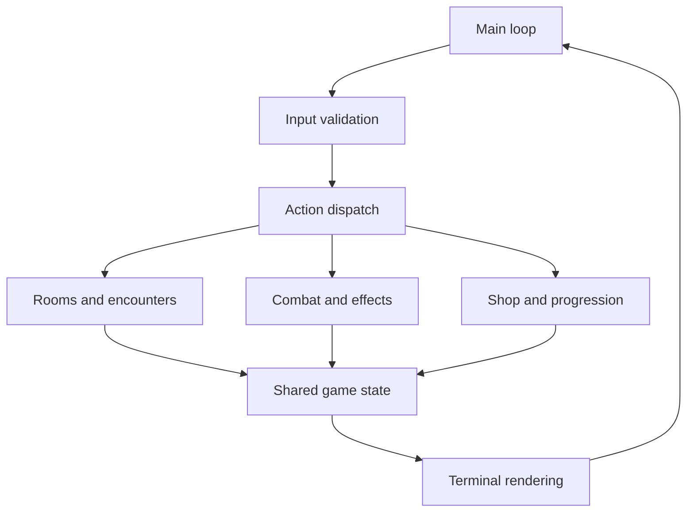
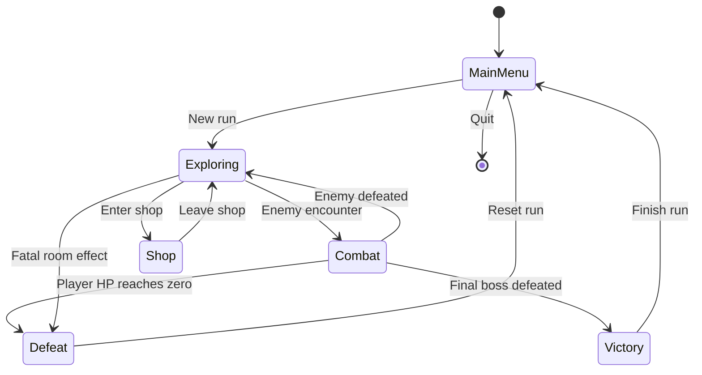

# Dungeon Master [WIP]

**Created by:** Brian Salinas, Ahmad Cheema, Kidduz Mulu, Shauryaveer Singh, and Mahir Kamal  
**Course:** CPSC 355  
**Language:** ARMv8/AArch64 assembly  
**Primary target:** AArch64 Linux using GNU assembler syntax

> **Status:** Project proposal and proposed development architecture. Features, filenames, interfaces, and build conventions below describe the intended implementation. No source repository was supplied for verification, so this document does not claim that the game or build targets already exist.

## 1. Project proposal

### Problem definition and objectives

Dungeon Master is a text-based dungeon roleplaying game implemented in ARMv8/AArch64 assembly. Players explore connected rooms, encounter enemies, and make decisions that affect their survival and progression. Combat, currency, equipment, experience, skill points, and traits form an interconnected progression system leading toward a final boss.

Players earn rewards by clearing encounters, purchase weapons and items, and spend skill points to unlock abilities or traits. Some traits provide benefits alongside disadvantages, encouraging different strategies. Health, damage, equipment, and status effects influence the outcome of each encounter. Reaching zero health ends the run; starting again resets that run's progression.

The project demonstrates practical use of registers, memory, arithmetic, conditional branching, loops, procedures, and structured program design. Its complexity comes from coordinating game systems consistently: a purchase must update currency and inventory together, an encounter must grant rewards only once, and a combat turn must apply its effects in a predictable order.

### Planned player actions

- Navigate a numbered terminal menu and move between available dungeon rooms.
- Inspect health, equipment, currency, experience, skill points, and active traits.
- Attack, defend, and eventually use special moves during combat.
- Collect rewards and purchase equipment or consumable items.
- Gain levels and spend skill points on character progression.
- Make choices that introduce positive or negative effects.
- Defeat the final boss to win, or restart after losing all health.

### Scope and feasibility

| Stage | Deliverable | Completion condition |
| --- | --- | --- |
| First playable version | Menu, one room, one enemy, attack/defend, victory/defeat | A complete encounter can be played without a crash |
| Core dungeon | Connected rooms, final boss, currency, basic shop, inventory | A complete run can be finished and restarted |
| Progression | Experience, levels, skill points, weapon upgrades, a small trait set | Spending and rewards preserve state invariants |
| Extended mechanics | Poison, special moves, meaningful room decisions | Each effect has documented timing and tested interactions |
| Optional polish | Colours, richer terminal layout, extra encounters | Existing gameplay and plain-text operation remain reliable |

Keep the initial room and item catalogues small and fixed. Procedural generation, multiplayer, a graphical window, and disk-based save files are outside the initial scope. Expand content after the complete game loop works. Confirm course rules for external libraries and any non-assembly helper code before adopting them.

## 2. ARMv8/AArch64 approach

| Course concept | Application |
| --- | --- |
| Registers | Temporary HP, damage, menu choices, indexes, arguments, and return values |
| Memory access | Player state, enemy state, inventory, room flags, and item definitions |
| Arithmetic | Damage, rewards, prices, experience, and percentage modifiers |
| Comparisons and branches | Input validation, affordability, death checks, room access, and outcomes |
| Loops | Main menu, combat turns, inventory traversal, and room selection |
| Procedures | Reusable routines for combat, movement, transactions, input, and rendering |
| Stack | Saved registers, return addresses, and local temporary values |

A **procedure** is a named routine, similar to a function. A caller uses `bl procedure_name`, and the routine normally returns with `ret`. A routine that makes another call must preserve its incoming return address appropriately.

Long-lived game values belong in memory. Registers hold working copies while a procedure runs. Here, persistent game state means state that lasts throughout a run; it does not imply storage that survives closing the program.

## 3. Proposed architecture

Use a single-threaded, turn-based state machine. The main loop coordinates systems; each feature owns its rules and returns a result for the UI to display.



### State transitions




### State ownership and interfaces

Define memory offsets once in `include/state.inc`. Suggested structures:

- **PlayerState:** current/max HP, attack, defence, currency, experience, level, skill points, equipped weapon, trait flags, poison duration, and inventory.
- **EnemyState:** current/max HP, attack, defence, behaviour, and reward values.
- **RunState:** current room, active game mode, cleared-room flags, and optional random seed.
- **Definition tables:** immutable item prices, weapon bonuses, enemy templates, and room connections.
- **Level State**: Mutable integer that includes User's level, Enemy's level, and Skill points calculation (Max is 100 * 2 skill points)


Start with documented 32-bit nonnegative fields for bounded counters and IDs; use 64-bit registers for pointers. Match every load/store width to the field definition. Check arithmetic bounds and use wider intermediates where multiplication could overflow. For example, calculate a percentage-modified damage value in 64 bits before dividing and applying a documented cap.


## 4. Gameplay consistency

### Proposed combat order

1. Read and validate an action. Invalid input consumes no turn.
2. Apply the player's action: attack, defend, item use, or an unlocked special move.
3. Check enemy death immediately. A defeated enemy does not attack.
4. If alive, resolve the enemy action and then check player death.
5. If both remain alive, apply end-of-turn effects in a documented order, checking death after each effect.
6. Expire temporary effects, display the outcome, and continue if appropriate.

Suggested starting rules: damage is `max(1, attack - defence)`; HP is clamped at zero; defend reduces the next enemy attack and then expires. Specify rounding for modifiers. Agree whether poison takes effect on the application turn, and use the same rule everywhere. Mark a cleared encounter before granting its reward again could become possible.

### All-or-nothing shop transactions (Database integrity) 

Validate every condition before changing currency or inventory:

1. Is the item ID valid?
2. Is the item available, and are level/trait requirements met?
3. Is there enough currency?
4. Is there inventory capacity, and is the item not already owned if unique?
5. Will the resulting values stay within their limits?
6. Commit currency and inventory/equipment updates with no remaining expected failure points.
7. Return a success code; let the UI print the result afterward.

Example: a weapon costs 30 coins. With 25 coins, reject the purchase and leave all state unchanged. With exactly 30 coins and a free inventory slot, add the weapon and set the balance to zero. With a full inventory, reject without charging.

This follows the **all-or-nothing principle associated with atomicity**. It is not a database transaction, a CPU atomic instruction, or crash-safe persistence. In this single-threaded design, game actions cannot observe a half-completed successful purchase. Avoid fallible calls during the commit phase. If later work introduces persistence or concurrency, this guarantee must be redesigned.

Apply the same validation pattern to skill-point spending. Reset every run-owned field on restart, including poison, inventory, unlocked traits, currency, room flags, and enemy state.

## 5. Team organization

| Member | Primary responsibilities | Integration boundary |
| --- | --- | --- |
| Brian Salinas | Architecture, Git coordination, core loop, final integration, currency, transactions, progression, and skill spending; collaborate on poison | Own shared contracts and economy rules; coordinate contract changes |
| Ahmad Cheema | Terminal UI for currency, shops, and skill spending | Call economy procedures and display returned results |
| Kidduz Mulu | Combat calculations and player/enemy statistics | Own attack/defend resolution and statistical effects of special moves |
| Shauryaveer Singh (Shaura) | Rooms, movement, encounters, and world-state transitions; collaborate on status effects and action availability | Own encounter activation; coordinate special-move rules with Kidduz and poison with Brian |
| Mahir Kamal | Dungeon and battle terminal UI, action prompts, and result messages | Display world/combat state and forward validated actions |

The combat/world split avoids having two implementations of attack and defence. Shared UI input routines should also have one implementation. Review interface changes with affected teammates before merging.


## 6. Playing the game

Proposed controls use numbered menus followed by Enter:

1. Select **New Run** to initialize a character.
2. Inspect the room and choose an available exit or interaction.
3. During combat, choose **Attack**, **Defend**, or an available special action.
4. Spend earned currency in a shop and skill points through the progression menu.
5. Continue toward the final boss.
6. After victory or defeat, return to the main menu; a new run begins with reset progress.

Final option numbers should match the implemented UI. EOF should exit cleanly; invalid input should display a helpful message and prompt again without spending resources or advancing a turn.

## 7. Git and GitHub workflow

### Configure your identity once

```bash
git config --global user.name "Your Name"
git config --global user.email "your-github-email@example.com"
```

Use a verified GitHub email or your GitHub no-reply address if you want contributions linked to your account.

### Start a feature

Begin with a clean working tree:

```bash
git switch main
git pull --ff-only origin main
git switch -c feature/shop-validation
```

Suggested branch names include `feature/combat`, `feature/rooms`, `feature/shop-ui`, and `feature/battle-ui`.

### Review, commit, and push

```bash
git status
git diff
git add src/economy/shop.S
git diff --cached
git commit -m "Validate purchases before changing player state"
git push -u origin feature/shop-validation
```

Stage only the intended files. Never commit generated executables, object files, access tokens, or private credentials.

### Integrate updates from main

Commit your current work before merging:

```bash
git fetch origin
git merge origin/main
```

If conflicts occur, open each conflicted file, reconcile the intended code, and remove the conflict markers. Then stage resolved files, finish the merge, rebuild, and test:
(IDE should have a visualization for the merge conflict where you can resolve it!)


Use `git merge --abort` if you need to abandon an in-progress merge. Do not discard teammates' changes just to remove a conflict. Updating regularly reduces branch divergence; it does not eliminate conflicts.

### Pull-request checklist

- Explain the feature and any shared-interface changes.
- Compile and exercise the affected gameplay path.
- Include the tested environment and observed result.
- Ask an affected teammate to review; Brian coordinates final integration.
- Merge after review and successful checks, then update local `main`.

Keep shared contracts small and stable. Protect `main` from direct pushes if the repository configuration supports it. Refer to the [official Git branching and merging guide](https://git-scm.com/book/en/v2/Git-Branching-Basic-Branching-and-Merging).


    


### 7.2. Windows: install Ubuntu with WSL 2

#### Step 1 — Prepare Windows

Use Windows 11, or a Windows version supported by Microsoft's WSL installation instructions. The simplified installation command requires Windows 10 version 2004/build 19041 or later. This technical minimum does not establish the support status of your Windows edition.

Save open work before restarting. You need internet access, disk space, and permission to install Windows features. If virtualization is disabled, WSL 2 may require enabling Intel VT-x or AMD-V/SVM in your computer's firmware settings; follow the computer manufacturer's instructions.

#### Step 2 — Open an administrator terminal

1. Open **Start** and search for **PowerShell** or **Terminal**.
2. Right-click it and choose **Run as administrator**.
3. Accept the Windows permission prompt.
4. If using Terminal, select a PowerShell tab.

**Windows PowerShell — Administrator:**

```powershell
wsl --list --online
wsl --install -d Ubuntu-24.04
```

Use the exact distribution name from the list if it differs. Restart Windows if requested. Reference: [Microsoft WSL installation](https://learn.microsoft.com/en-us/windows/wsl/install).

#### Step 3 — Finish Ubuntu's first launch

Open the installed Ubuntu application from Start. Allow initial setup to finish, then choose a Linux username and password. This Linux account is separate from your Windows account. When entering a terminal password, characters usually remain invisible; type it normally and press Enter.


### 7.3. Docker Method (Windows, macOS, and Linux) — Recommended

Dungeon Master uses **Docker** to provide a consistent Linux development environment for compiling and running ARMv8/AArch64 assembly code.

This allows contributors using Windows, macOS, or Linux to work with the same development tools without manually configuring an AArch64 cross-compiler on their host operating system.

Our Docker environment uses **Ubuntu 24.04** and the dependencies specified in the project's `Dockerfile`.

#### Why Docker?

- **Cross-platform compatibility:** Windows, macOS, and Linux contributors can share one development environment.
- **Consistent dependencies:** All team members use the tools installed in the same Docker image.
- **Simplified installation:** Avoid manually configuring the ARMv8/AArch64 toolchain on every machine.
- **Isolation:** The development environment runs inside a container rather than directly on the host operating system.
- **Reproducibility:** Teammates can rebuild the environment from the repository's Dockerfile.

Docker does not execute assembly source code directly. The container provides the assembler, linker, and tools needed to compile and execute the game.

#### Step 1 — Install Docker

**Windows and macOS:**

Download and install [Docker Desktop](https://www.docker.com/products/docker-desktop/).

1. Select the installer matching your operating system and processor architecture.
2. Complete the installation.
3. Start Docker Desktop.
4. Confirm that the Docker Engine is running.

For Windows users, Docker Desktop generally uses the WSL 2 backend for Linux containers.

For macOS users, Docker Desktop provides a Linux container environment without requiring a manually configured Ubuntu virtual machine.

**Linux:**

Install [Docker Engine](https://docs.docker.com/engine/install/) using the instructions for your distribution.

#### Step 2 — Verify Docker installation

Open your terminal.

On Windows, use PowerShell. On macOS, use Terminal.

Run:

```bash
docker --version
```

Then verify that Docker can execute containers:

```bash
docker run --rm hello-world
```

A successful message confirms that Docker is installed and the Docker Engine is accessible.

#### Step 3 — Clone the repository

Clone the Dungeon Master repository using Git:

```bash
git clone <REPOSITORY-URL>
cd Dungeon-Master
```

Replace `<REPOSITORY-URL>` with the team's actual GitHub repository URL.

Make sure the project folder contains the `Dockerfile`.

#### Step 4 — Build the Docker image

Inside the project directory, run:

```bash
docker build -t dungeon-master-dev .
```

This command:

1. Reads the Dockerfile.
2. Downloads the configured Ubuntu base image if necessary.
3. Installs the required development dependencies.
4. Creates a local Docker image named `dungeon-master-dev`.

The initial build may require downloading dependencies. Subsequent container launches reuse the existing image.

Rebuild the image when the Dockerfile or its installed dependencies change.

#### Step 5 — Run the Docker container

**macOS / Linux (Bash or Zsh):**

```bash
docker run --rm -it \
  --mount "type=bind,source=$(pwd),target=/workspace" \
  -w /workspace \
  dungeon-master-dev sh
```

**Windows (PowerShell):**

```powershell
docker run --rm -it --mount "type=bind,source=$($PWD.Path),target=/workspace" -w /workspace dungeon-master-dev sh
```

These commands start an interactive shell inside the container.

**Command explanation:**

| Argument | Purpose |
| --- | --- |
| `docker run` | Creates and starts a container |
| `--rm` | Automatically removes the container after it exits |
| `-it` | Enables interactive terminal input and output |
| `--mount` | Mounts the local project folder inside the container |
| `-w /workspace` | Sets the container's working directory |
| `dungeon-master-dev` | Specifies the Docker image |
| `sh` | Starts a shell inside the container |

The bind mount allows edits made in VS Code to be visible immediately inside `/workspace`.

A container does not need to be rebuilt every time an assembly source file changes.

**Important:** Removing the container does not delete your local project files because they reside in the bind-mounted project directory.

#### Step 6 — Verify the assembly development environment

Inside the container, run:

```bash
pwd
ls
aarch64-linux-gnu-as --version
aarch64-linux-gnu-gcc --version
```

The expected working directory is:

```text
/workspace
```

Check the target architecture:

```bash
uname -m
```

An `x86_64` result means the Linux container is running on x86-64. AArch64 executables will normally require an emulator such as QEMU.

An `aarch64` result means the container itself is running on ARM64 Linux, where compatible ARM64 Linux executables can run natively.

#### Step 7 — Compile and execute assembly code

For a standalone GNU AArch64 assembly file named `main.asm` that defines `_start` and has no unresolved external dependencies:

```bash
aarch64-linux-gnu-as -o /tmp/main.o main.asm
aarch64-linux-gnu-ld -o /tmp/dungeon-master-dev /tmp/main.o
```

On an x86-64 Linux container with QEMU user-mode emulation installed:

```bash
qemu-aarch64 /tmp/dungeon-master-dev
```

On a native ARM64 Linux container:

```bash
/tmp/dungeon-master-dev
```

**Note:** Dungeon Master contains multiple planned assembly modules. Once the modules are integrated, the build process must assemble and link every required object file rather than only `main.asm`.

Use the project's actual build script or Makefile when one becomes available.


#### Step 8 — Exit and clean up

To leave the container:

```bash
exit
```

Because the container was started with `--rm`, Docker automatically removes it after it exits.

The Docker image remains available for future runs.

To view Docker images:

```bash
docker images
```

To view running containers:

```bash
docker ps
```

To remove the Dungeon Master image when it is no longer needed:

```bash
docker image rm dungeon-master-dev
```

Do not remove the image while other containers still depend on it.

#### Common Docker problems

| Problem | Possible solution |
| --- | --- |
| `docker: command not found` | Install Docker and restart the terminal |
| Cannot connect to Docker daemon | Start Docker Desktop or the Docker Engine |
| Docker build fails | Inspect the Dockerfile and package installation errors |
| `Dockerfile` not found | Run the build command from the project root |
| Mount source path does not exist | Verify the current directory and shell-specific mount syntax |
| `Permission denied` | Check file permissions and Docker access |
| `Exec format error` | Confirm the executable architecture and use QEMU if necessary |
| `qemu-aarch64: command not found` | Install QEMU user-mode emulation in the container |
| Undefined references during linking | Assemble and link all required modules |
| Container exits immediately | Launch it with an interactive shell or inspect its startup command |


**Docker is a development and execution environment, not a substitute for implementing the game in assembly.** The Dungeon Master gameplay systems remain written in ARMv8/AArch64 assembly. This is to assist and centralize our development environment, not to replace the assembly implementation. 


## 8. Editors, IDEs, GitHub connection, and terminals

### Choose your editor

**Recommended team setup:** VS Code for editing and Git review, with compilation and execution in the Linux environment from section 7. An editor does not replace the AArch64 assembler, linker, debugger, or emulator.

| Option | Why choose it? | Project-specific considerations |
| --- | --- | --- |
| [Visual Studio Code](https://code.visualstudio.com/) | Built-in Git interface, integrated terminal, and GitHub extensions | Recommended starting point; use the terminal build commands before configuring Run/Debug buttons |
| [CLion](https://www.jetbrains.com/clion/) | IDE with Git integration, terminal, and build/debug tooling | Requires configuration for this assembly project and its Linux toolchain; do not assume its C/C++ defaults provide complete AArch64 source support |
| [VSCodium](https://vscodium.com/) | Alternative editor built from the open-source VS Code codebase | Uses Open VSX by default; extension availability and licensing differ, so do not assume Microsoft GitHub or Remote extensions are interchangeable |
| [GitHub Desktop](https://desktop.github.com/download/) plus an editor | Visual Git workflow for teammates who prefer buttons | A Git client, not an IDE/compiler; official downloads cover Windows and macOS; it does not manage a Linux VM's separate clone automatically |

References: [VS Code source control](https://code.visualstudio.com/docs/sourcecontrol/overview), [CLion introduction](https://www.jetbrains.com/help/clion/clion-quick-start-guide.html), and [VSCodium extension differences](https://github.com/VSCodium/vscodium/blob/master/docs/extensions.md).

### Understand the tools first

| Term | Meaning for this project |
| --- | --- |
| Editor / IDE | The application used to edit and navigate source files |
| Terminal | The window in which you interact with a command-line shell |
| Shell | Bash, Zsh, or PowerShell interpreting your commands |
| Git | Local version-control program tracking files and commits |
| GitHub | Online service hosting the shared Git repository and pull requests |
| Clone | Your local working copy of the shared repository |
| Commit | A saved snapshot in local Git history |
| Push | Upload local commits to a remote repository |
| Pull request | A proposed branch change for review before merging |

Saving a file does not commit it. Committing does not upload it. Pushing a feature branch does not merge it into `main`.

### Install Git and connect your GitHub account

1. Create or sign in to your account at [GitHub](https://github.com/). Accept the team's repository invitation if it is private.
2. Install Git in the environment that owns your clone. Ubuntu instructions are in section 7; other platforms have installers linked from [Git downloads](https://git-scm.com/downloads).
3. Open a terminal and check `git --version`. Configure your name and email using section 9.
4. Choose either VS Code's browser sign-in when prompted for a GitHub operation, or the GitHub CLI method below.

Your Git name/email identify commits; they do **not** log you into GitHub. A public repository may clone without login, while pushing requires authentication and repository access.

For a repeatable terminal setup, install [GitHub CLI](https://cli.github.com/) **in the same environment as Git**, then run:

```bash
gh auth login
gh auth setup-git
gh auth status
```

During login, choose **GitHub.com**, **HTTPS**, and browser authentication; follow the displayed instructions. This also works for a VM or SSH session when the device-login page is opened in your host browser. Do not use your GitHub account password as an HTTPS Git password. Keep any tokens out of source files and remote URLs. See the [GitHub CLI authentication manual](https://cli.github.com/manual/gh_auth_login).

### VS Code: open the team repository

1. Install VS Code and open the Command Palette: **Ctrl+Shift+P** on Windows/Linux or **Cmd+Shift+P** on macOS.
2. Run **Git: Clone**, paste the team's GitHub repository URL, and choose a parent directory.
3. Open the cloned folder when prompted. If you already cloned it, use **File → Open Folder** instead.
4. Open **Source Control** in the sidebar to see changed files and Git actions.
5. Use the branch selector in the status bar to create a feature branch from updated `main`.

Clone the existing team repository; do not create a separate empty repository for your contribution. Instructions: [repositories and remotes](https://code.visualstudio.com/docs/sourcecontrol/repos-remotes).

### VS Code: everyday contribution workflow

1. Save your changes and select each changed file in **Source Control** to inspect its diff.
2. Stage only the intended files with the **+** action.
3. Enter a useful commit message and select **Commit**.
4. Use **Publish Branch** for a new local branch or **Push** for an existing remote branch.
5. On GitHub, open a pull request with `main` as the base and your feature branch as the comparison branch.
6. Request review, address feedback, and follow the team's merge process in section 9.

The editor and command-line Git operate on the same clone. **Sync Changes** can both pull and push; learn those operations separately before using it. See [staging and commits](https://code.visualstudio.com/docs/sourcecontrol/staging-commits).

### Useful VS Code extensions

- **GitHub Pull Requests and Issues**, published by GitHub: review and create pull requests inside the editor. Built-in Git support already handles ordinary commits and branches.
- **Remote - SSH**, published by Microsoft: edit files on a Linux VM or course host through SSH.
- An optional **AArch64/ARM64 syntax-highlighting extension**: confirm it supports GNU assembler syntax and uppercase `.S` files before recommending one to the whole team.

Use the Extensions view to inspect the publisher and documentation before installing. A syntax extension does not install GCC or make the Run button know how to link multiple assembly modules. Begin with section 7's explicit build commands. See [GitHub in VS Code](https://code.visualstudio.com/docs/sourcecontrol/github).

### Use VS Code with the Linux VM or course host

For a GUI-enabled Linux VM, installing VS Code inside the guest keeps the editor, Git clone, terminal, and compiler together. Another route is VS Code on the host connected to Linux using Remote - SSH:

1. Obtain the Linux username and reachable host/address. The machine needs an SSH server and must allow your login.
2. Verify ordinary SSH access from your host terminal using the actual connection details:

```bash
ssh YOUR-LINUX-USER@YOUR-LINUX-HOST
```

3. In VS Code, install **Remote - SSH**, then run **Remote-SSH: Connect to Host...** and select or enter that connection.
4. Open or clone the project **on the Linux machine**. Open **Terminal → New Terminal** in that remote window.
5. Run `uname -s`, `uname -m`, and `pwd` to confirm the OS, architecture, and current directory before building.

SSH access to Linux and GitHub authentication are separate connections. Configure GitHub access where Git actually runs. VM networking, hostname, and SSH-port setup depend on the VM; do not assume a generic address will work. See the [official Remote - SSH guide](https://code.visualstudio.com/docs/remote/ssh).

### Terminal basics

In VS Code choose **Terminal → New Terminal**. Multiple terminals are useful: one can run the game while another runs Git or GDB. For interactive game input, use a terminal rather than an output-only panel. See [VS Code terminal basics](https://code.visualstudio.com/docs/terminal/basics).

The commands below assume a Linux Bash shell (including one inside a VM or remote session):

| Command or key | Purpose |
| --- | --- |
| `pwd` | Show the current directory |
| `ls` | List files in that directory |
| `cd dungeon-master` | Enter the project folder from its parent |
| `cd ..` | Move up one directory |
| `cd "folder with spaces"` | Enter a path containing spaces |
| `mkdir -p build` | Create the build directory if needed |
| `git status` | Check branch and changed/staged files |
| `git diff` | Review unstaged tracked-file changes |
| `git diff --cached` | Review staged changes before committing |
| `git log --oneline -5` | View the latest five commits |
| `git remote -v` | Check the configured repository URLs |
| `clear` | Clear the terminal display |
| Tab | Complete a command or path where supported |
| Up arrow | Recall a previous command |
| Ctrl+C | Interrupt the foreground program |
| `exit` | Close a shell or leave an SSH session |

Paths and filenames are case-sensitive on the Linux development filesystem. Copy commands without a leading prompt symbol such as `$`. PowerShell, Git Bash, and macOS Terminal do not automatically provide the Linux environment required by this project's build instructions.

For example, on native ARM64 Linux, after building successfully with section 7:

```bash
pwd
git status
./build/dungeon-master
```

On x86-64 Linux, launch the same target binary through QEMU instead:

```bash
qemu-aarch64 -L /usr/aarch64-linux-gnu ./build/dungeon-master
```

### CLion: alternative IDE workflow

1. Install CLion using its [installation guide](https://www.jetbrains.com/help/clion/installation-guide.html); check the current licence terms for your use.
2. Use **Get from VCS** or the clone action to open the team's repository, or open an existing clone.
3. Configure Git under **Settings → Version Control → Git**. GitHub account integration is under **Version Control → GitHub**.
4. Use the branch selector, commit view, and push action for the workflow in section 9.
5. Open the **Terminal** tool window to execute the same Git and Linux build commands.

Makefile/custom-build integration can be configured after the repository has a working build definition. For now, use the terminal; a project import alone does not configure an AArch64 compiler or QEMU runner. A locally installed CLion terminal also remains local unless you explicitly use a remote environment. References: [Git repository setup](https://www.jetbrains.com/help/clion/set-up-a-git-repository.html), [GitHub integration](https://www.jetbrains.com/help/clion/github.html), and [terminal documentation](https://www.jetbrains.com/help/clion/terminal-emulator.html).

### VSCodium and GitHub Desktop alternatives

**VSCodium:** Open the repository folder and use its Git interface or integrated terminal. The terminal Git/GitHub CLI workflow above avoids depending on a particular GitHub extension. Check the Open VSX listing for any extension you need rather than assuming VS Code's complete extension setup transfers unchanged.

**GitHub Desktop:** Sign in, clone the repository, create a branch, review changed files, write a commit summary, and push or publish the branch. Open the folder in your chosen editor to modify code; open a pull request on GitHub for review. If building inside a Linux VM with a separate clone, push your branch and pull it inside Linux before compiling. Keep track of which clone contains your latest edits.

### Common setup problems

| Symptom | What to check |
| --- | --- |
| `git: command not found` | Install Git in the active host/VM/remote environment; restart the terminal if necessary |
| `not a git repository` | Use `pwd`, then enter the cloned project directory |
| `Repository not found` | Verify URL, signed-in account, and private-repository invitation |
| Authentication or permission error on push | Check `gh auth status`, repository permissions, and `git remote -v` |
| Changes are committed but absent on GitHub | Push the correct branch; then select that branch on GitHub |
| Push rejected because remote history advanced | Fetch and inspect changes; integrate them using section 9; avoid force-pushing shared work |
| `gcc` rejects AArch64 instructions | Confirm the target compiler and architecture in section 7 |
| `Exec format error` | On x86-64 Linux, use QEMU for the AArch64 executable |
| `code: command not found` | Open the folder from VS Code's menu; its optional shell launcher may not be configured |
| Run button fails while the terminal build works | Configure a build/debug task later; syntax highlighting alone does not define a build |

### Tutorials to work through

1. [VS Code source-control quickstart](https://code.visualstudio.com/docs/sourcecontrol/quickstart): practise a first commit in a separate disposable repository.
2. [VS Code GitHub guide](https://code.visualstudio.com/docs/sourcecontrol/github): learn repository and pull-request integration.
3. [VS Code terminal guide](https://code.visualstudio.com/docs/terminal/basics): learn terminal navigation and multiple sessions.
4. [Git introductory videos](https://git-scm.com/videos): watch **What is Version Control?**, **Get Going with Git**, and **Quick Wins with Git**.
5. Use the actual team repository to create a branch, make one small reviewed change, push, and open a pull request.

## 9. Validation plan

| Scenario | Expected result |
| --- | --- |
| Nonnumeric, empty, or out-of-range menu choice | Re-prompt; state unchanged |
| EOF while waiting for input | Clean exit, no infinite loop |
| Attack reduces enemy HP below zero | HP becomes zero; enemy cannot retaliate |
| Defend action | Reduction applies for the documented duration only |
| Poison expires or kills a participant | Exact timing and outcome match the agreed rules |
| Insufficient funds or full inventory | Currency and inventory both remain unchanged |
| Purchase with exact funds | Correct item added; currency becomes zero |
| Invalid item or trait ID | Reject before indexing a table or changing state |
| Re-enter a cleared room | No duplicate reward |
| Large experience reward | Every applicable level-up occurs within limits |
| Restart after defeat | All run-owned state returns to initial values |
| Complete dungeon | Final boss victory leads to the correct ending |

Test feature boundaries early: a battle reward should feed the shop, an equipment upgrade should affect combat, and a status effect should survive room changes only if the design says so. Use fixed seeds for reproducible random encounters. The final demonstration should include both a successful run and an invalid purchase.

## 10. Learning resources and videos

### Videos

The [official Git video collection](https://git-scm.com/videos) includes:

| Video | Focus |
| --- | --- |
| [VS Code Git Tutorial](https://www.youtube.com/watch?v=i_23KUAEtUM) | Using Git in VS Code |
| [How to Connect VS Code to GitHub](https://www.youtube.com/watch?v=V7WpadAi3RI) | Connecting VS Code to GitHub |
| [CLion / JetBrains Git Tutorial](https://www.youtube.com/watch?v=9eBieLWZQOM) | Using Git in JetBrains IDEs |
| What is Version Control? | Why a team keeps version history |
| What is Git? | Git's purpose and basic model |
| Get Going with Git | Getting started |
| Quick Wins with Git | Useful everyday practices |

These are external introductory videos, not demonstrations of this project. For assembly walkthroughs, prefer material explicitly labelled **AArch64/ARM64 with GNU assembler on Linux**; ARM32 and x86 examples use different registers and conventions.

### Technical references

- [Apple ARM64 documentation](https://developer.apple.com/documentation/xcode/writing-arm64-code-for-apple-platforms): future native-macOS port considerations.
- [Pro Git](https://git-scm.com/book/en/v2): collaboration and branch management.

### Team demonstration videos to record

1. **Setup:** clone, compile, and launch on the course environment.
2. **Gameplay:** movement, combat, shop, progression, and final outcome.
3. **Architecture:** trace one menu action through a procedure into game-state memory.
4. **Validation:** demonstrate a rejected transaction and a clean reset after defeat.

Add recording links once those videos exist. Before presenting this README as release documentation, replace placeholders, reconcile the file list with the actual repository, and verify each supported build route.
